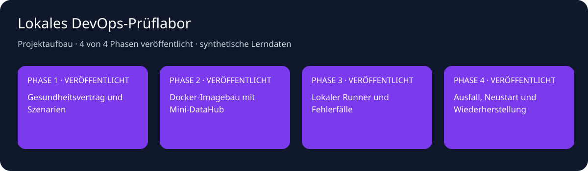

# Lokales DevOps-Prüflabor

Ein Dienst soll reproduzierbar gebaut und gestartet werden; Gesundheitsprüfung, Konfigurationsfehler und Wiederherstellung müssen beobachtbar sein.



**Veröffentlichungsstand: Phase 3/4.** Dieses eigenständige Repository übernimmt zunächst den bereits lokal committeten Stand. Weitere fachliche Phasen werden im Abstand von mindestens vier Stunden veröffentlicht. Die technische Entwicklung und die öffentliche Veröffentlichung haben unterschiedliche echte Zeitpunkte.

## Was hier zu sehen ist

| Schritt | Inhalt | Hier veröffentlicht |
|---|---|---|
| 1 | Gesundheitsvertrag und Szenarien | Ja |
| 2 | Docker-Imagebau mit Mini-DataHub | Ja |
| 3 | Lokaler Runner und Fehlerfälle | Ja |
| 4 | Ausfall, Neustart und Wiederherstellung | Folgt |

## Fachlicher Nutzen

Containerisierung, automatisierte lokale Prüfungen und Fehlerdiagnose.

## Lokal starten

Im geklonten Repository ausführen; die benötigte Laufzeit muss installiert sein. Python-Beispiele verwenden 3.12, Node-Beispiele 24 und C# die im Projekt angegebene .NET-Version. Befehle mit uv laden die dort genau bezeichneten Pakete bei Bedarf.

```powershell
git clone https://github.com/Jorxas/mini-datahub-api.git ../02-mini-datahub
node nachweise/p07-t01-pruefen.cjs
node pipeline/lokal.cjs
```

Ausführliche technische Befehle: [START.md](START.md). [Öffentlicher Prüfstand](ABNAHME.json) und [Quellphasen](VERLAUF.json) dokumentieren Herkunft und echte Ausführungsdaten. Eine neue Repositorykopie ist kein neuer nativer Desktoplauf.

## Ergebnis des lokal geprüften Schlussstands

Echter Imagebau, HTTP-503-Fehler, Konfigurationsfehler sowie Stoppen und Wiederherstellen geprüft.

**Dieser Schlussstand ist lokal bereits geprüft, aber noch nicht vollständig in diesem Repository veröffentlicht.** Maßgeblich für den hier verfügbaren Code ist die Phasentabelle oben.

## Grenzen

Keine AWS-/Azure-Ausführung und keine entfernte CI-Plattform. Ab Phase 2 wird das separat veröffentlichte Mini-DataHub als dokumentierte Dienstabhängigkeit benötigt.

Eigenes kleines Lernprojekt mit synthetischen Daten, mit KI-Unterstützung entwickelt und geprüft. Keine Aussage über Berufserfahrung, menschliche Arbeitsstunden oder praktische Verwendung weiterer nur geplanter Produkte.

## Entwicklungshistorie

[Entwicklungshistorie](HISTORIE.md): die vorhandenen lokalen Änderungen, ihre ursprünglichen Daten und die spätere GitHub-Übernahme.
